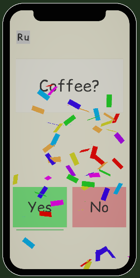
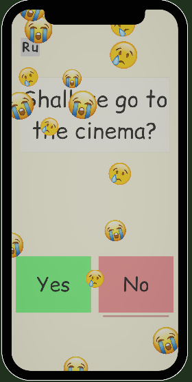

# ☕ pick-app3000

The ultimate high-stakes question delivery tool. Built in **Unity** with **0 lines of code** — not a single script, not even a stray semicolon.

Designed to ask the hard questions so you don't have to face the awkward silence in person.

---

## 📥 Download

Grab the latest build here:  
👉 [**Download pick-app3000 (Latest Release)**](https://github.com/Ciretrus/Pick-App3000/releases/tag/release)

---

## 📸 Screenshots

  
  

---

## 🎯 What it does

- **100% No-Code**: Powered purely by Unity Inspector events, native UI clicks, and sheer willpower.
- **The Good Ending (Yes)**: Hit it and trigger an instant explosion of celebratory confetti.
- **Emotional Damage (No)**: Hit it and get drowned in a dramatic shower of crying emojis.
- **Evidence Under the Buttons**: Missed the animation? The underline under "Yes" or "No" keeps the score long after the confetti settles.
- **International Flirting**: Toggle between English and Russian with a single tap.

---

## 🕹 How to use

1. Hand the phone over.
2. Cross your fingers for the confetti.
3. Look for the underline below the buttons if the screen was turned away.
4. Accept the verdict.